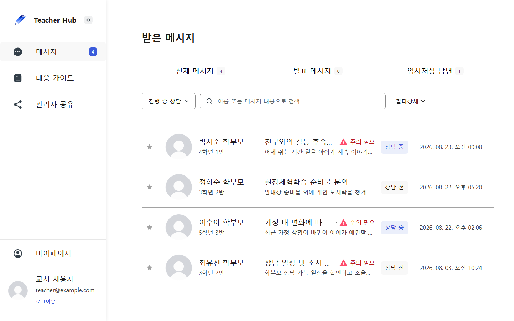
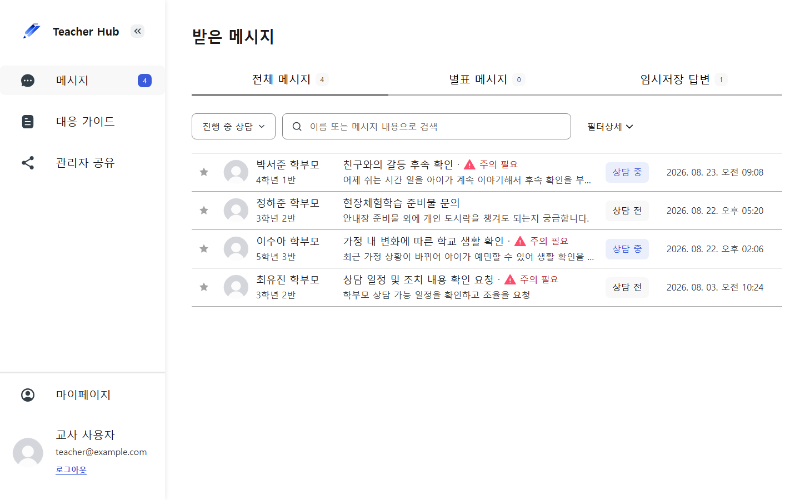
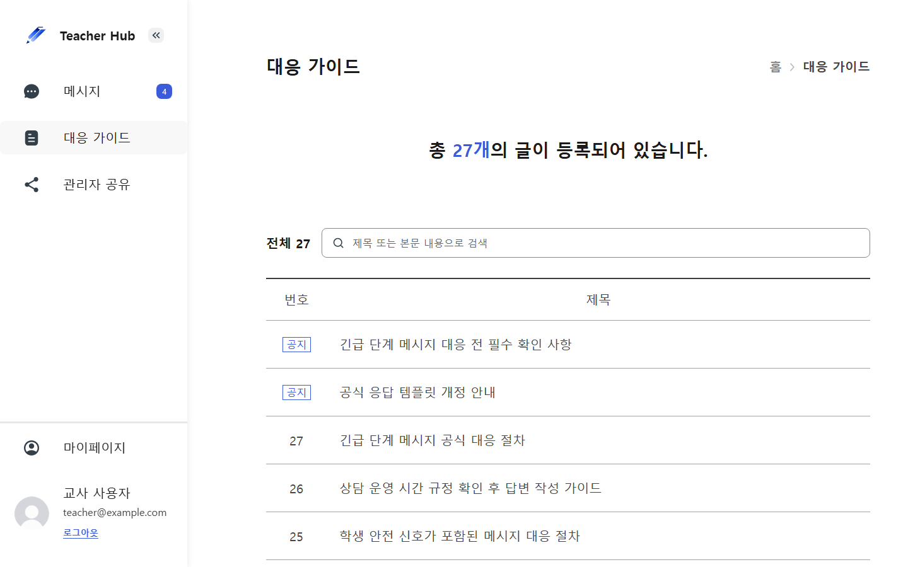
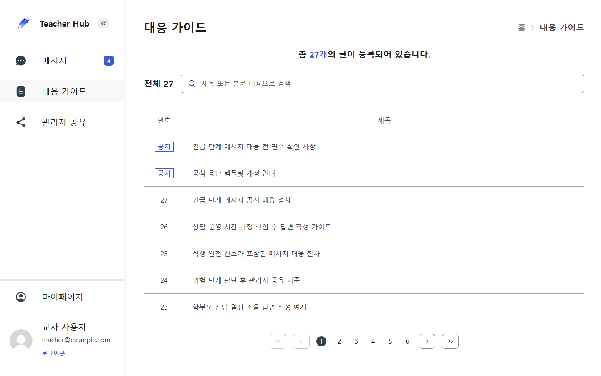
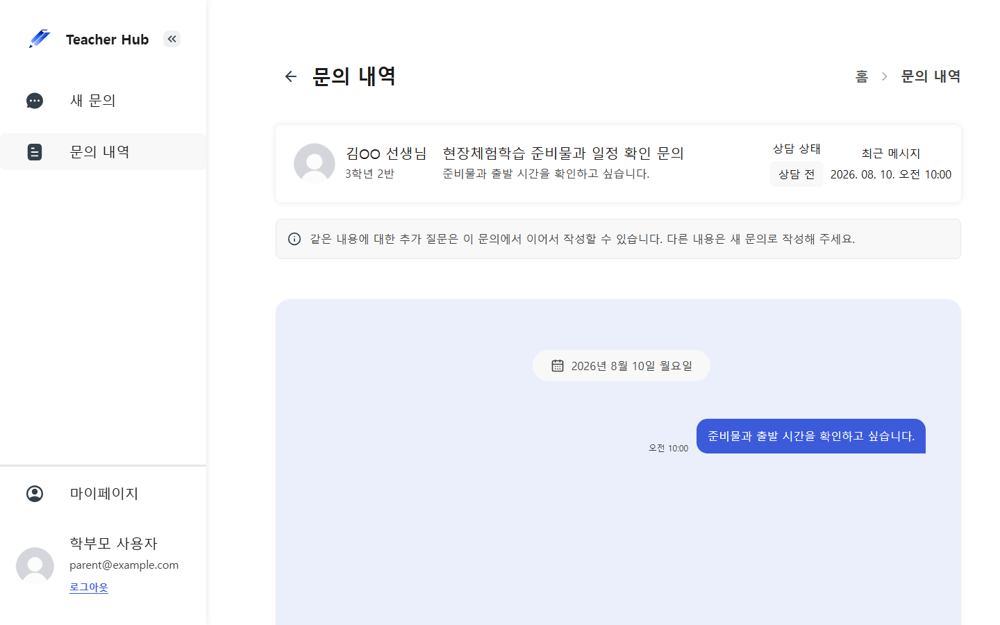
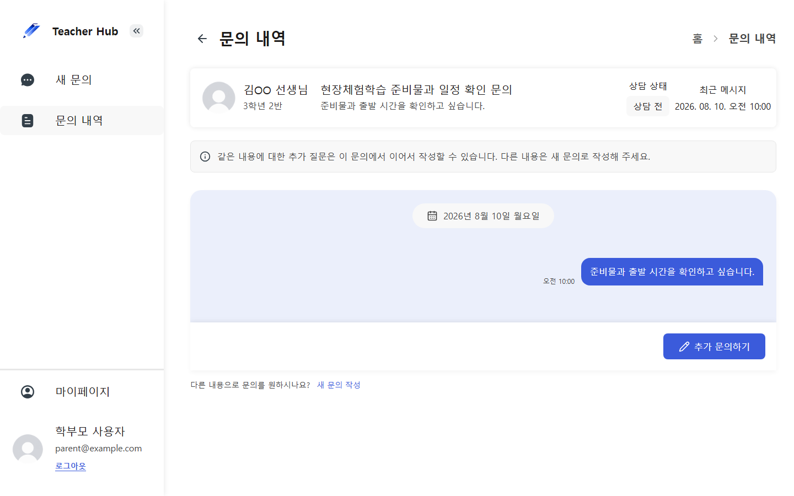
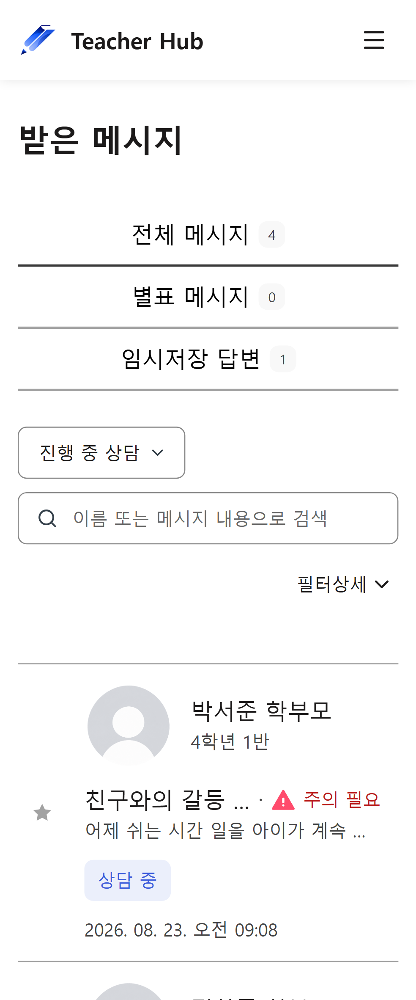

# Issue #91 작업 ③ — 데스크톱 업무 화면 밀도

PR #99가 머지된 `dev` (`a168a8c`)에서 분기한 `fix/91-density-ui` 작업이다. 기존 작업 폴더의 학부모 위험 분석 관련 미커밋 변경은 보존하고 별도 worktree에서 구현했다.

## 확인한 원인과 변경

전역 배율 대신 981px 이상 업무 화면의 간격·최소 높이·목록 프로필 크기를 조정했다. 기존 `DESIGN.md`의 spacing 토큰을 재사용했다. 980px 이하의 모바일/태블릿 간격, 사이드바 폭, 본문 16px, 검색창 47px, 위험 안내·안전 잠금·승인 버튼은 유지했다. 행과 대화는 내용이 길어지면 늘어난다.

| 영역 | 기존 | 변경 |
| --- | --- | --- |
| 업무 shell | 상단 88px, 좌측 100px(가이드 125px) | 상단·좌측 48px, 우측 32px |
| 교사 목록 | 최소 행 높이 112px, 프로필 80px | 최소 68px, 프로필 48px; 이름·제목 18px, 본문 16px |
| 목록·상세·작성 정렬 | 상세 가운데 정렬, 페이지별 시작선 차이 | 데스크톱 본문 컨테이너 시작선을 맞춤 |
| 상세·작성 카드 | padding 24px, 섹션 간격 32px | padding 20px, 섹션 간격 24px |
| 가이드 | 요약 위 96px, 검색 위 106px, 행 최소 76px | 간격 32px, 행 최소 64px |
| 가이드 상세 | 제목 위 100px, 본문 padding 위아래 72px | 각각 32px; 본문 16px·행간 24px |
| 학부모 목록 | 행 최소 109px, 검색 위아래 50/54px | 행 최소 68px, 검색 위아래 24px |
| 학부모 상세 | 본문 위 100px, 대화 최소 757px | 본문 위 32px, 대화 최소 240px |
| 학부모 새 문의 | 입력 52px, 폼 간격 24px | 입력 47px, 폼 간격 20px |
| 관리자 목록·상세 | 교사 shell·목록·카드 공통 사용 | 공통 영역의 밀도 개선을 함께 적용; 처리·승인 UI 유지 |

1440×900 mock 화면에서 교사 첫 행은 y=355에서 275로 올라갔고, 변경 후 행 높이는 69px(경계 포함)이다. 짧은 학부모 문의의 대화 영역은 240px로 표시되며 추가 문의 버튼이 첫 화면 안에 들어온다. 실제 변경 후 좌표와 크기는 `metrics-1440.json`, `metrics-1024.json`, `metrics-768.json`, `metrics-375.json`에 기록했다.

## 화면 비교

같은 로컬 mock 데이터로 촬영했다. 모바일은 CSS viewport 375px이고 기기 DPR이 적용되어 이미지 픽셀 수가 다르다. 웹폰트가 로드되지 않는 실행 환경에서는 대체 글꼴이 보일 수 있으며 이번 변경에 폰트 설정 수정은 없다.

| 화면 | 변경 전 | 변경 후 |
| --- | --- | --- |
| 교사 목록 1440px |  |  |
| 대응 가이드 1440px |  |  |
| 학부모 상세 1440px |  |  |
| 교사 목록 375px |  |  |

## 검증

- 변경 전 기준 캡처: 1440/1024/768/375px 모두 통과.
- 변경 후 업무 화면 검증 4개: 교사 목록·상세·답변 작성·가이드·관리자 공유, 학부모 새 문의·목록·상세, 관리자 목록. 가로 넘침, 편집 가능 상태, 본문 16px, 검색창 47px·focus, 별표 44px, 짧은 문의의 추가 문의 버튼 위치를 확인했다.
- 기존 회귀 18개: 관리자 검토·완료와 긴급 하향 승인, 검색창 및 가이드 탐색, 학부모 추가 문의→교사 답변→학부모 완료, 분석 대기 하단 배치, Low/High 답변 전송과 Emergency 잠금. 데스크톱 학부모 왕복 테스트가 최초 실행에서 30초 timeout으로 실패했으며, 코드·timeout 변경 없이 재실행해 11.3초에 통과했다.
- 기존 긴 대화·작성 참고사항·전송 확인 모달 검증 1개: 1440px에서 긴 답변의 스크롤·동의 체크·취소 후 초안 보존과 여러 위험 단계의 대화 표시를 확인했다.
- 총 23개 고유 시나리오 통과. 마지막 실행의 5개 skip은 화면 폭과 Playwright 기기를 중복 실행하지 않기 위한 조건이다.
- 가이드 제목과 학부모 대화 본문의 글자 200% 확대를 확인했다. 모든 화면·모든 요소에 대한 200% 확대 인증을 의미하지 않는다.
- build, lint, Playwright TypeScript 검사 통과. 기존 500kB 초과 번들 경고는 남아 있다.

실행한 주요 명령(격리 서버 `PLAYWRIGHT_BASE_URL=http://127.0.0.1:5190`, mock 어댑터):

```powershell
npx.cmd playwright test tests/auth/workspace-density.spec.ts --workers 1
npx.cmd playwright test tests/auth/teacher-message-layout.spec.ts tests/auth/teacher-reply-flow.spec.ts tests/auth/admin-escalation.spec.ts tests/auth/parent-message-history.spec.ts tests/auth/guide-search-ui.spec.ts --grep '분석 대기 하단|Low 메시지는 출처|High 메시지는 공식|Emergency 잠금|관리자는 공유받은|긴급 하향 승인 시|완료된 문의를 추가 질문|네 목록 검색창|대응 가이드 두 열' --workers 1
npx.cmd playwright test tests/auth/workspace-density.spec.ts tests/auth/teacher-message-layout.spec.ts tests/auth/parent-message-history.spec.ts --grep 'px 업무|1440px에서 짧고|완료된 문의를 추가 질문' --workers 1
```

## PR #100 리뷰 반영

CodeRabbit이 지적한 학부모 문의 목록의 검색창·동기화 오류 안내 겹침을 수정했다. 데스크톱 검색창 아래 간격이 24px로 줄어든 상태에서 오류 안내의 기존 `margin-top: -30px`이 남아 실제로 6px 겹쳤다. 981px 이상에서 오류 안내의 위 여백만 0으로 덮어썼으며, 모바일과 상세 화면의 기존 여백은 유지한다.

- 일회성 HTTP 응답 대체 검증으로 수정 전 6px 겹침을 재현했다. 수정 후 1440/1024/981px에서는 간격 24px, 980/768px에서는 기존 24px, 375px에서는 기존 2px을 확인했다.
- 데스크톱·모바일 2개 검증에서 오류 안내 표시, 가로 넘침 없음, 재시도 후 오류 해제와 저장된 문의 표시를 확인했다.
- 기존 업무 화면 검증 4개 폭을 다시 실행했다. build, lint, Playwright TypeScript 검사도 다시 통과했다. 기존 번들 크기 경고는 남아 있다.

## 변경 파일과 범위

제품 변경은 CSS 5개다: `teacher-prototype.css`, `MessagesPage.responsive.css`, `TeacherGuide.css`, `ParentMessageHistory.css`, `ParentMessageComposer.css`. 신규 테스트는 `workspace-density.spec.ts`다. `zoom`, `transform: scale()`과 전역 글자 축소는 사용하지 않았다.

API·인증·위험도 계산·원문 권한·전송·증빙 패키지 로직은 수정하지 않았다. 이전 PR의 상세 상단 요약, 규칙 기반 안내, 자동 검색과 댓글 수 제거를 유지했다. 실제 서버/배포 환경, 전체 회귀 스위트, 모든 브라우저의 동작은 이번 검증 범위에 포함하지 않았다.
