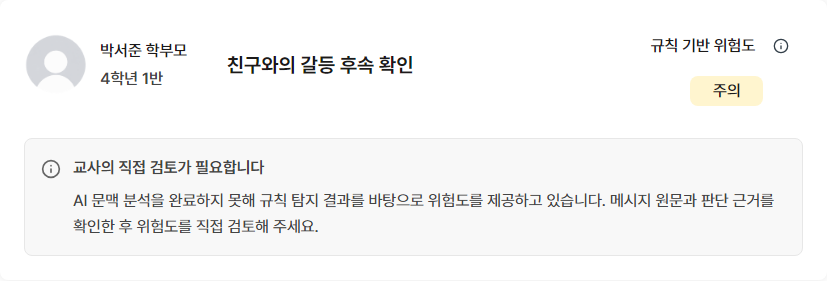
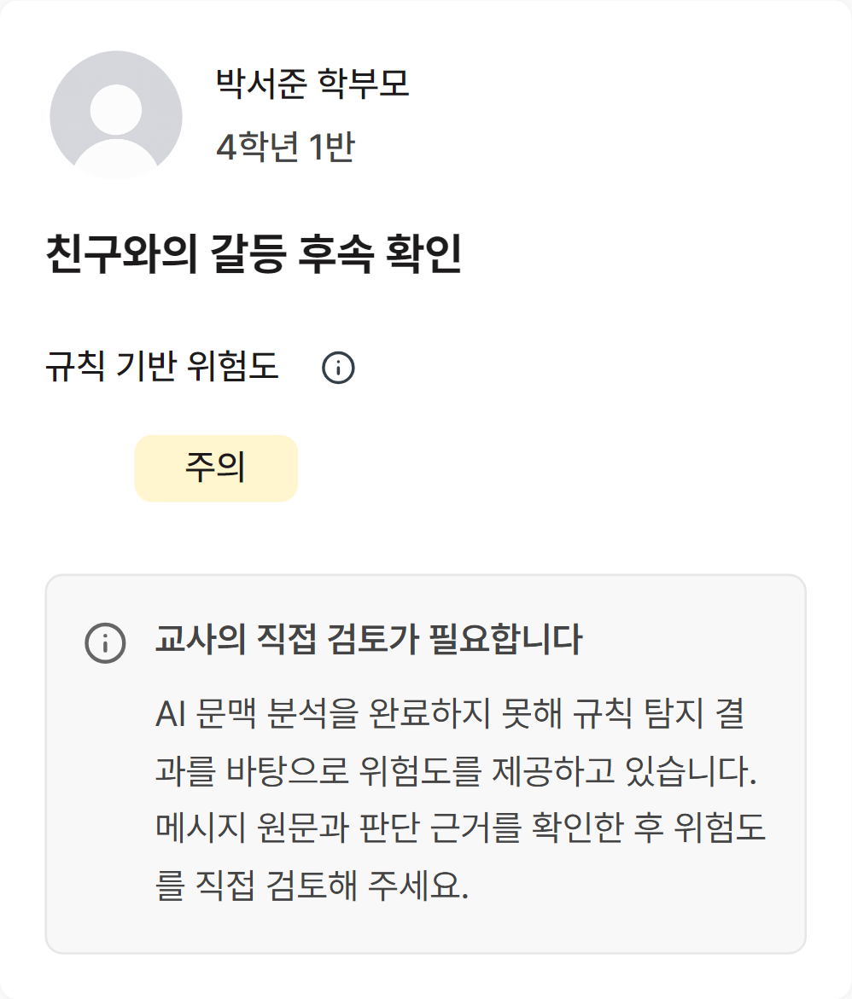

# #91 교사 메시지 상세의 분석 상태 안내 개선

## 배경과 범위

규칙 기반 분석 상태에 경고색과 `잠정 분석` 배지를 사용하고, 동일한 안내를 상단 카드와 위험 요소 탭에 각각 표시해 메시지 위험 경고처럼 보였다. 교사 메시지 상세에서 분석 상태를 중립적인 안내로 구분한다.

`fix/91-neutral-risk-notice`는 dev의 `70945a4`에서 분기했다. 상세 전환 안정화 PR #97과 별개이며 해당 PR의 변경은 포함하지 않는다.

## 변경 전후

| 항목 | 변경 전 | 변경 후 |
| --- | --- | --- |
| 규칙 기반 라벨 | 규칙 기반 잠정 위험도 | 규칙 기반 위험도 |
| 배지 | 실제 위험도와 별도로 잠정 분석 표시 | 실제 위험도만 유지: 일반·주의·위험·긴급 |
| 안내 위치 | 상단 카드 + 위험 요소 탭 | 상단 카드 내부 한 곳 |
| 안내 스타일 | 노란 경고 배경, 여러 상태 문구 | 회색 배경·경계·정보 아이콘, 제목 하나와 설명 두 문장 |
| 툴팁 | 잠정 위험도와 AI 미사용 설명 | 규칙 기반 위험도의 의미와 문맥 분석 한계 |
| 서버 안내 문구 | 검토 안내 뒤에 추가 표시 | 규칙 기반 검토 안내는 정리된 문구로 제공 |

안내 제목은 `교사의 직접 검토가 필요합니다`이며, AI 완료 후 수동 검토만 필요한 경우에는 AI 실패 문장을 표시하지 않는다. 분석 횟수 제한은 별도의 기존 설명을 유지한다.

## 변경 후 화면

아래는 로컬 mock 데이터로 촬영한 실제 Chromium 화면이다. 예시 데이터의 실제 위험도는 `주의`이며, `일반`도 별도 테스트로 확인했다. 변경 전 화면 캡처는 없으며 위 비교표는 기존 코드 기준이다.

### 데스크톱

### 모바일

## 검증 결과

- `npm.cmd run build`: 통과. 기존 500 kB 번들 크기 경고 있음.
- `npm.cmd run lint`: 통과.
- `npx.cmd tsc -p tsconfig.playwright.json`: 통과.
- `teacher-message-analysis.spec.ts` 관련 테스트: 데스크톱·모바일 16개 통과.
  - 일반 배지, 규칙 기반 라벨·툴팁, 키보드 focus/Escape
  - 안내 단일 표시, 서버의 중복 문구 제거, 중립 배경·경계·글자색
  - 시스템 100점과 교사 7단계 구분
  - 일반·주의·위험·긴급 배지 유지
  - 분석 실패·로딩·잘못된 응답 시 답변 차단 및 정상 복구
  - AI 완료 후 직접 검토를 분석 실패로 표시하지 않음
- 레이아웃 추가 테스트: 데스크톱·모바일 프로젝트 2개 통과.
  - 768px·375px 화면의 가로 넘침 없음
  - 카드 내부 글꼴의 계산된 크기를 2배로 적용하여 텍스트 확대 모사: 안내 잘림 없음, 툴팁 접근 및 Escape 후 포커스 유지
  - 최초 확대 테스트는 px 토큰에 루트 글꼴 확대가 적용되지 않아 실패했으며, 실제 계산된 크기를 확대하는 방식으로 보정 후 통과

## 영향과 한계

- 변경 파일: `TeacherMessages.tsx`, `MessageContextCard.tsx`, `AiRiskLabel.tsx`, `RiskAnalysisNotice.tsx`, `RiskAnalysisNotice.css`, 관련 Playwright 테스트 및 이 기록.
- 위험도 계산, 위험도 검토·권한·안전 잠금·전송 정책, API 계약은 변경하지 않았다.
- 공통 컴포넌트의 교사 전용 표시 옵션으로 적용하여 학부모·관리자의 기존 표시는 유지한다.
- 실제 운영 서버 응답·로그인, 운영 배포 화면, 모든 브라우저의 네이티브 확대, 전체 회귀 테스트는 이번에 실행하지 않았다.
- PR은 자동으로 머지하지 않는다.
