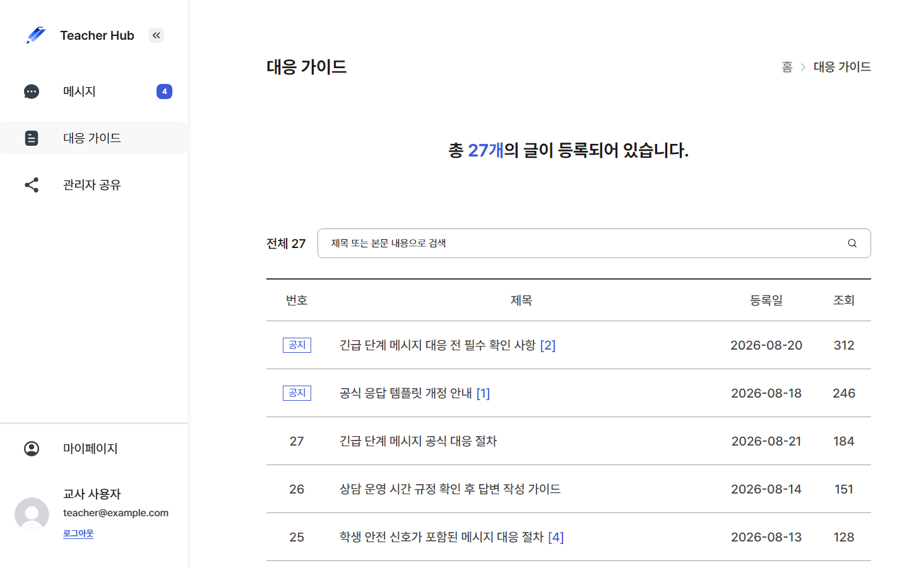
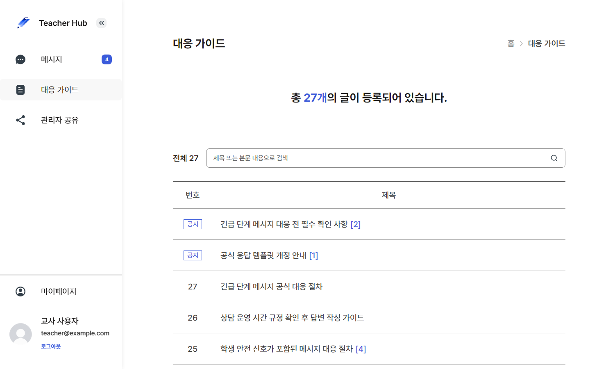
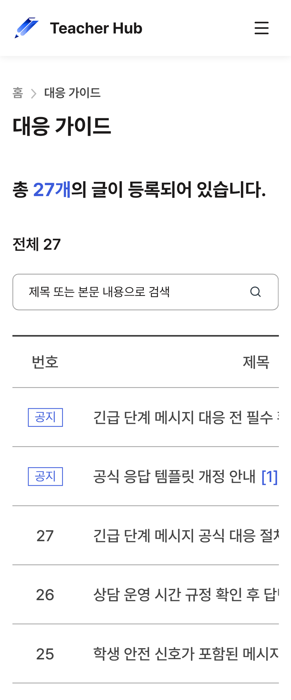
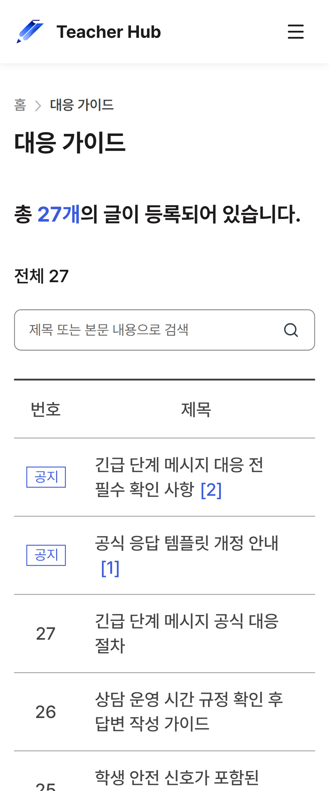

# Issue #91 작업 ② — 문구·대응 가이드·검색창

기준: PR #97·#98이 머지된 `dev` (`db563a5`), 브랜치 `fix/91-labels-guide-search`.

## 변경과 근거

- 교사 목록은 `추가 문의 도착`, 학부모 목록은 `새 답변 도착`으로 표시한다. 교사 상단 안내도 도착한 대화 건수로 설명한다. `needsTeacherReview`, `needsParentReview`, 확인 처리와 API 상태값은 유지한다.
- 위험도 검토 툴팁은 “시스템 위험 점수와 교사 검토 점수는 서로 다른 기준입니다. 교사 검토는 1~7단계로 진행됩니다.”로 정리한다. 실제 점수 `n/100`은 유지하며 0점과 점수 미제공을 구분한다.
- 대응 가이드 목록을 번호·제목 2열로 바꾸고 목록 날짜·조회수와 상세 등록일을 UI에서 제거한다. 날짜·조회수 데이터는 유지한다. 기존 모바일 `min-width: 760px`과 제목 한 줄 제한으로 생기던 가로 스크롤을 없애고 제목을 줄바꿈한다.
- 교사 메시지, 대응 가이드, 학부모 문의, 교사의 관리자 공유 내역(`/teacher/admin-share`) 검색에 기존 `TextField`와 `ui-search-field`를 사용한다. 높이 47px, padding 16px, 아이콘 20px, 아이콘 간격 12px, 반경 8px과 기존 테두리·placeholder·hover·focus 토큰을 공유한다. 화면별 너비와 검색 방식·버튼·서버 검색어 100자 제한은 유지한다.
- 수정 전 가이드 검색창에 포커스를 주어도 테두리가 회색으로 남는 것을 자동화 테스트로 재현했다. 원인은 페이지 CSS가 공통 focus 테두리와 그림자를 덮어쓰던 것이며 해당 규칙을 제거했다.

## 화면 비교

동일한 로컬 mock 데이터와 화면 크기를 사용했다. 모바일 이미지는 CSS viewport 375px, 기기 DPR 2.625다.

| 화면 | 변경 전 | 변경 후 |
| --- | --- | --- |
| 가이드 1440px |  |  |
| 가이드 375px |  |  |

## 검증

- `npm.cmd run build`: 통과. 기존 500kB 초과 번들 경고는 남아 있다.
- `npm.cmd run lint`, `npx.cmd tsc -p tsconfig.playwright.json`: 통과.
- 신규 검색/가이드 테스트: 4개 통과(데스크톱·모바일 각 2개). 네 검색창의 입력·초기화·크기·포커스, 가이드 검색 빈 상태·상세 본문·키보드 진입·이전/다음 글·목록 복귀를 검증했다. 가이드는 1440/1024/768/375px의 가로 넘침과 목록 글자 200% 확대를 확인했다.
- 기존 관련 회귀 테스트 20개 통과: 문의 검색·중요 표시, 추가 문의→교사 답변→학부모 완료, 역할별 배지 표시/해제, 가이드에서 메시지 복귀, 규칙 기반 안내 중복 방지, 0점/미제공 툴팁·터치·Escape, 위험 필터와 1~7단계 수동 검토.
- HTTP 어댑터 테스트 4개 통과: 관리자 공유의 위험도·학생명 검색 요청과 빈 결과, 메시지 목록 복귀 시 검색·필터·별표·사이드바 상태 보존(각 데스크톱·모바일).
- HTTP 검증을 동시에 시작한 최초 실행에서 데스크톱 2건이 30초 timeout에 걸렸다. 각 테스트를 단독 실행해 같은 30초 제한과 코드로 재검증했고 관리자 공유 23.5초, 목록 상태 보존 19.0초에 통과했다. 모바일은 최초 실행에서 통과했다.
- 가이드 최초 검증의 화면 크기 변경 직후 assertion 1건은 기존 200ms 레이아웃 transition 도중 실행되어 실패했다. 같은 넘침 조건을 `expect.poll`로 기다리도록 테스트를 수정한 뒤 두 프로젝트 모두 통과했다. 제품 transition과 허용 오차는 바꾸지 않았다.

재실행 명령:

```powershell
npx.cmd playwright test tests/auth/guide-search-ui.spec.ts --workers 1
npx.cmd playwright test tests/auth/parent-message-history.spec.ts tests/auth/teacher-message-analysis.spec.ts tests/auth/teacher-message-board.spec.ts --grep '본인 문의만|완료된 문의를 추가 질문|완료되지 않은 문의의 추가 질문|Rule-only 검토 안내|점수 도움말|공식 절차를 보고|필터상세에서|교사가 1~7점' --workers 1
npx.cmd playwright test -c playwright.admin-http.config.ts tests/admin/teacher-escalations-http.spec.ts --grep '위험도와 학생명 검색' --workers 1
npx.cmd playwright test -c playwright.integration-http.config.ts tests/integration/message-detail-stability.spec.ts --grep '검색·필터·별표' --workers 1
```

## 영향 범위와 미검증 항목

- 변경 파일: `TeacherMessages.tsx`, `MessageHistoryPage.tsx`, `AdminSharePanel.tsx`, `TeacherGuide.tsx`와 해당 페이지 CSS, `teacher-prototype.css`, 테스트 3개. 공통 스타일은 네 검색창의 클래스에만 적용한다.
- 위험도 계산·권한·안전 잠금·전송 정책·API 요청/응답은 수정하지 않았다. PR #98에서 복원한 상세 상단 요약도 유지한다.
- 검증은 로컬 mock 및 요청을 가로챈 HTTP 어댑터 환경이다. 실제 서버·배포 환경과 전체 회귀 스위트를 검증했다는 의미는 아니다.
- 가이드 상세 첨부자료 렌더링과 링크 조건은 유지했다. 현재 로컬 데이터에는 다운로드 URL이 없어 실제 다운로드는 검증하지 못했다.
- 전체 화면 밀도 조정은 작업 ③의 별도 PR로 진행한다.
