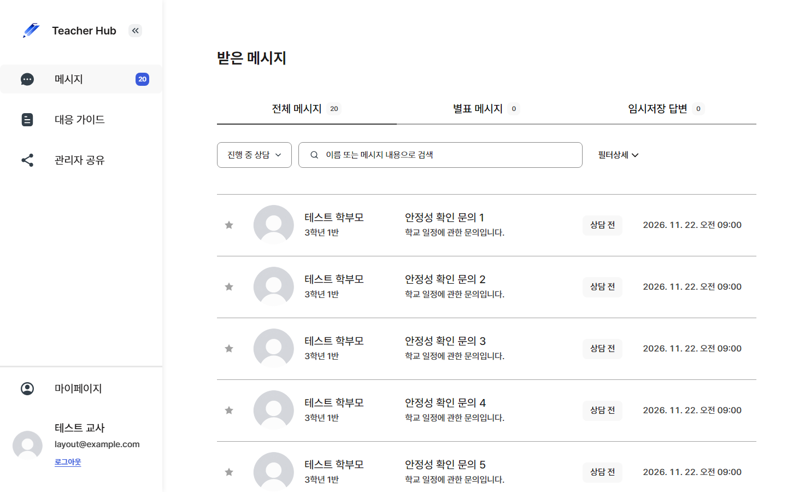
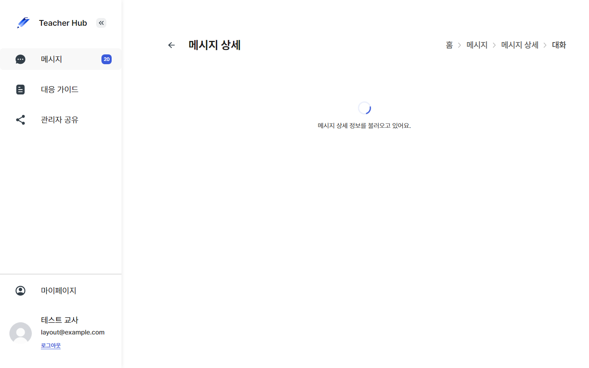
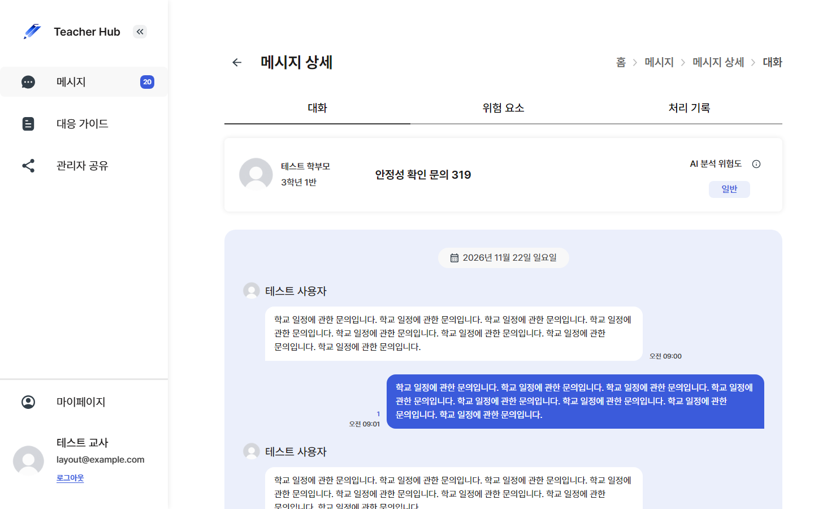
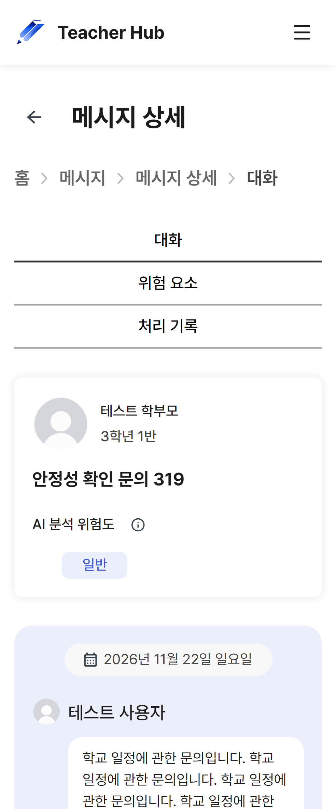

# #91 메시지 상세 전환 안정화

기준 커밋은 PR #96이 머지된 `dev`의 `70945a4`입니다. 작업 ①만 포함하며 문구·검색창·대응가이드·전체 정보 밀도 변경은 후속 PR 범위입니다.

## 원인 확인과 수정

운영 사이트는 gstack `/browse`로 열었으나 로그인 화면으로 이동했습니다. 아래 재현은 실제 Chromium에서 로컬 앱의 HTTP 어댑터에 모의 응답을 제공한 결과이며 운영 계정 검증과 구분합니다.

| 후보 | 확인 결과 및 처리 |
| --- | --- |
| `pushState` 뒤 스크롤 초기화 없음 | 코드에서 확인. 메시지 화면 내부에서 다른 문의를 열 때 DOM 반영 후 첫 페인트 전에 상단으로 이동합니다. |
| 목록 스크롤 승계·복원 | 목록 20행을 스크롤한 뒤 상세를 열고 돌아오는 테스트에서, 기존 목록 버튼은 `scrollY=1796` 대신 `0`으로 복귀했습니다. 목록 위치를 별도로 기억하여 버튼·뒤로가기에서 복원합니다. 짧은 상세의 브라우저 스크롤 보정에 의존하지 않도록 긴 대화 재진입도 검증합니다. |
| 데이터 로딩 전후 구조·높이 차이 | 980px 이하의 단일 열 grid가 짧은 로딩 화면의 여유 높이를 상단 메뉴 행에 배분했습니다. 로딩 후 제목 y좌표가 768px에서 `290 → 124`, 375px에서 `292 → 112`로 이동한 것을 측정했습니다. 해당 breakpoint에 `grid-template-rows: auto 1fr`만 추가했습니다. |
| `selectedThread`가 없으면 목록 표시 | 목록 응답에 포함되지 않은 상세 URL `/319`에서 상세 응답을 지연시키면 실제로 목록이 표시됐습니다. 이제 경로의 `selectedThreadId`로 상세 shell을 선택하고 로딩·실패·잘못된 주소를 처리합니다. |
| 목록·상세 최대 너비와 정렬 | 기존 목록 1188px, 상세 1053px의 목적별 상한을 유지합니다. 로딩 상태와 완료 상태는 같은 `.board-detail` 및 헤더를 사용합니다. 네 폭에서 제목 x/y좌표 불변을 검사합니다. |
| 200ms transition | grid 열·padding-left·width 전환은 사이드바 접힘에 사용됩니다. 제거하지 않았으며 접힘·펼침과 페이지 전환 후 상태를 검증했습니다. |
| 스크롤바에 따른 가용 너비 | 네 폭의 가로 넘침과 로딩 전후 제목 x좌표를 검사했습니다. 고전형 스크롤바의 모든 OS 설정은 재현하지 못했으므로 전역 scrollbar/overflow CSS를 추가하지 않았습니다. |

같은 문의의 대화·위험 요소·답변 작성 전환에는 새 스크롤 초기화를 적용하지 않습니다. 메시지 화면을 떠날 때 브라우저의 기존 `history.scrollRestoration` 설정을 복구합니다. 검색·필터·탭·목록 위치 보존은 현재 메시지 화면 세션 안에서 제공하며, 전체 새로고침 후 목록 필터를 영구 복원하는 기능을 추가한 것은 아닙니다.

상세 데이터가 아직 없을 때의 오류는 문의별로 보관하고 재시도 시 초기화합니다. 이미 로딩된 문의의 분석·권한·재시도 처리는 기존 경로를 유지합니다. 재진입 시 AI 초안 탭을 기본으로 여는 기존 동작도 유지하며, 직접 작성 탭의 편집 내용은 보존합니다.

## 화면 비교

1440px 상세 URL 직접 진입, 느린 응답:

| 수정 전: 목록이 잘못 표시됨 | 수정 후: 상세 헤더를 유지하며 로딩 |
| --- | --- |
|  |  |

응답 완료 후 같은 헤더 위치:



375px에서는 로딩·완료 모두 제목 위치를 유지합니다. 이미지의 디바이스 픽셀 비율은 CSS 화면 폭과 다릅니다.




## 검증 범위와 재실행

신규 `tests/integration/message-detail-stability.spec.ts`는 다음을 검사합니다.

- 1440·1024·768·375px 목록 상단/하단 진입, 캐시된 긴 대화 재진입
- 직접 URL·새로고침에서 느린 상세 응답, DOM 관찰을 통한 목록 노출 감지, 헤더 좌표 비교
- 목록 버튼·브라우저 뒤로가기/앞으로가기 및 목록 스크롤 복원
- 조회 실패·재시도, 느린 요청 중 목록 복귀, 잘못된 상세 주소
- 검색·상담 필터·별표 탭·사이드바 상태
- 답변 작성/닫기/뒤로가기/앞으로가기에서 직접 작성 내용 보존
- 편집기·버튼 글자 크기 200% 모의 확대 후 키보드로 닫기, 화면 이탈 후 스크롤 정책 복구

```powershell
npm.cmd run build
npm.cmd run lint
npx.cmd tsc -p tsconfig.playwright.json
npx.cmd playwright test -c playwright.integration-http.config.ts tests/integration/message-detail-stability.spec.ts --workers 2
npx.cmd playwright test tests/auth/teacher-message-board.spec.ts tests/auth/teacher-message-analysis.spec.ts tests/auth/teacher-reply-flow.spec.ts tests/auth/teacher-message-layout.spec.ts tests/auth/teacher-inbox-api.spec.ts tests/auth/teacher-reply-api.spec.ts tests/auth/privacy-safety.spec.ts tests/auth/admin-escalation.spec.ts --workers 2
```

위험도 계산, High/Emergency 제한, 안전 잠금, 원문 권한, 승인·공유, 전송·임시저장 및 API 계약을 변경하지 않습니다. 기존 테스트로 이 경로들의 회귀를 확인합니다. 운영 서버 로그인 검증, Safari/Firefox, OS별 고전형 스크롤바, 모든 텍스트에 대한 실제 브라우저 200% 확대 감사는 미검증입니다. 200% 검증은 이번 경로의 편집기·버튼 접근성에 한정합니다.
